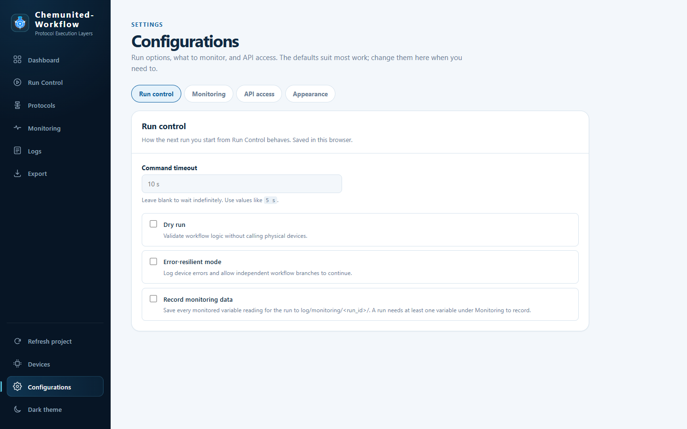

# Configurations

**Configurations** holds the settings most runs don't need to change: how runs behave, what monitoring polls, API
access, and the theme. Open it from **Configurations** at the bottom of the sidebar, under **Devices**. Each section
is a tab, and a link such as `/configurations#monitoring` opens that tab directly.

## Run control

These options apply to the next run you start from [Run Control](run_control.md), which shows the ones that are on
next to **Start Protocol**. They are saved in this browser: they stay set after a reload, while another browser or
computer keeps its own. They can't be changed while a run is active.

They start blank and off, unless the project sets its own defaults with `RunDefaults` in
`customizations/ui/ui_hook.py` (see [Customize dashboard](../developer/customize_dashboard.md)). A browser remembers
only the options you change; the others follow the project's defaults.

| Option | Description |
|---|---|
| **Command timeout** | Maximum time to wait for a single device command before it's considered failed (e.g. `10 s`). Leave blank to wait indefinitely. |
| **Dry run** | Validates the workflow's logic without actually calling physical devices — useful for checking a protocol is wired correctly before running it for real. |
| **Error-resilient mode** | Logs device errors but lets independent workflow branches keep running instead of stopping the whole run on the first failure. |
| **Record monitoring data** | Saves every reading of the variables listed under [Monitoring](#monitoring) for the run's whole duration. The run is refused if no variables are listed there. Only recorded runs have monitoring data to [export](export.md), as raw files, a CSV and a database. |

## Monitoring

What the work-server polls while monitoring is on, saved in the project (`connectivity/monitoring.json`). The
[Monitoring](monitoring.md) page plots these variables, the Dashboard's
[LCD readouts](../drawing/drawing.md#lcd-readouts) show them, and runs with **Record monitoring data** on save them.

| Field | Description |
|---|---|
| **Sample time (s)** | How often each variable is polled. |
| **Request timeout (s)** | How long to wait for a device to respond before treating that poll as failed. |
| **Component** | The device to read from, or `custom` for a source from the project's monitoring hook. |
| **GET variable** | Which of that device's `GET` commands to poll. |

Click **Add Variable** to add the selected component/command pair to the table below the form (shown with its
**Component**, **Command** and **Kwargs**). The same command can be added more than once with different parameters
(two channels of one ADC, for example): each keeps its own readings and profile. Every change is saved to the
project as you make it.

The settings are locked while monitoring is on, whether it was started from the Monitoring page or by a run. Stop it
on the Monitoring page, or let the run end, to change them.

## API access

* **Open API docs** opens the work-server's interactive OpenAPI reference in a new tab. See
  [API & MCP Tools](api_and_mcp.md).
* **API token** is only needed to change things (start runs, send commands, save settings) from another computer.
  Read-only requests, and any request from the work-server's own computer, never need it. Paste the token the
  work-server was started with (`--token` or `CHEMUNITED_API_TOKEN`, see
  [Starting the work-server manually](overview.md#starting-the-work-server-manually), or the
  [Dashboard Launcher](launcher.md)'s API token) and click **Save**: the dashboard then sends it with every change.
  **Clear** removes it. The token is stored in this browser only.

## Appearance

Switches between the light and dark theme, like the toggle at the bottom of the sidebar. On a phone, whose bottom
bar has no room for that toggle, this is where the theme is changed.
