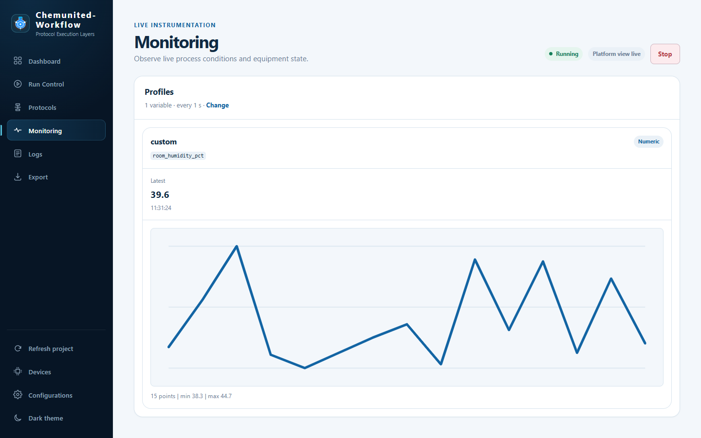

# Monitoring

<strong>💡 Information</strong> 
This page polls device variables on demand, independent of any run. To follow a protocol's steps and nodes
while it executes, use <a href="run_control.md">Run Control</a>.

**Monitoring** lets you poll live values from any connected device — useful for watching equipment state before,
between, or independently of runs (e.g. keeping an eye on a temperature reading while you set up a platform by
hand).

## Choosing what to monitor

The variables to poll, the sample time and the request timeout are set under
[Configurations → Monitoring](configurations.md#monitoring); **Change** next to the variable count opens it. Click
**Start** at the top to begin polling every variable in that list at the configured sample time.

## Start, Stop and the live platform view

**Start** and **Stop** also switch the Dashboard's [live platform view](overview.md#live-view): the diagram is live
while monitoring is on from this page (the header shows **Platform view live**).

* They work during a protocol run too. A run keeps monitoring on for its own duration either way; **Start** then
  makes the diagram live and keeps monitoring on after the run, and **Stop** turns the live view off while the run
  goes on polling until it ends.
* **Start** works with no variables in the list: the diagram goes live, with nothing to read.
* The monitoring settings stay locked while monitoring polls.

## Profiles

The **Profiles** card shows a live panel per polled variable once monitoring is on, plotting readings as they come
in. With no variables chosen yet, it shows **No variables selected**, with a link to Configurations.
