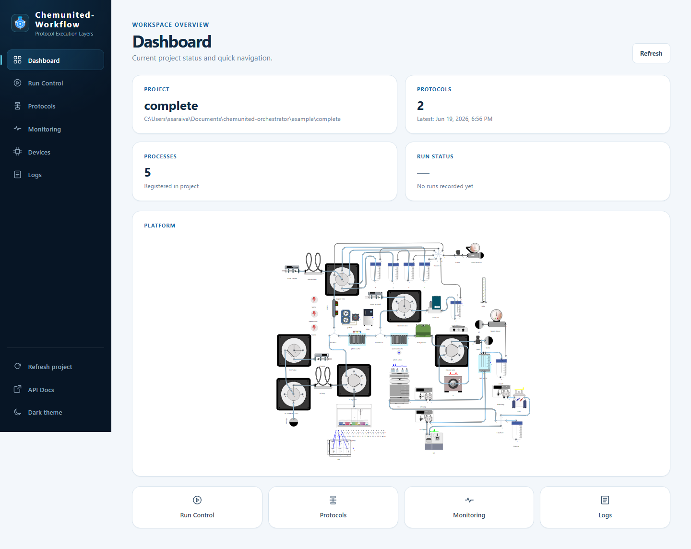

# Dashboard

The **Dashboard** is the browser-based web app served by the work-server (`chemunited-workflow`) alongside its
REST/MCP API. It's how you interact with a project — start runs, build protocols, watch live data, and check
connectivity — from any browser, without the desktop orchestrator app open. Start it from the desktop app's
[Dashboard Launcher](launcher.md), or run `chemunited-workflow serve` directly; either way it opens at
`http://127.0.0.1:<port>/` (default port `3116`).

The dashboard has six pages, reachable from the sidebar on the left of every page:

* **Dashboard** (this page) — project status at a glance and quick navigation.
* **[Run Control](run_control.md)** — start or cancel a run, and watch it execute live.
* **[Protocols](protocols.md)** — assemble processes into a saved, repeatable protocol.
* **[Monitoring](monitoring.md)** — poll live device variables outside of a run.
* **[Logs](logs.md)** — browse and tail execution log files.
* **[Devices](devices.md)** — check connectivity for every component in the project.

At the bottom of the sidebar: **Refresh project** (reload project state from disk), **API Docs** (opens the
work-server's OpenAPI docs — see [API & MCP Tools](api_and_mcp.md)), and a **Dark theme** toggle.

## Landing page



Four cards summarize the loaded project:

| Card | Shows |
|---|---|
| **Project** | The project's name and its folder path on disk. |
| **Protocols** | How many protocol files are saved, and when the most recent one was saved. |
| **Processes** | How many processes are registered in the project. |
| **Run Status** | Whether a run is currently active, or `No runs recorded yet`. |

**Refresh** re-reads all four cards from the server. Below them, the **Platform** card renders the project's
platform diagram (the same layout you build in [Drawing](../drawing/drawing.md)), useful for a quick visual sanity
check of the loaded setup. Click a component in the diagram to open its connectivity status and commands below it.
At the bottom, four quick-navigation cards jump straight to Run Control, Protocols, Monitoring, and Logs.

### Navigating the platform diagram

Large platforms can be explored right in the card:

| To | Do this |
|---|---|
| Zoom | **Ctrl** + scroll (**⌘** + scroll on macOS) over the diagram, pinch on a trackpad or touch screen, or use the zoom buttons. A plain scroll still scrolls the page. |
| Pan | Drag the diagram (one finger on a touch screen). A click without dragging still selects a component. |
| See the whole platform | **Fit to view** (the house button), like **Home** on the desktop canvas. |
| Find a component | Pick it from the **Find component** list: the view zooms to it and selects it. |
| Get more room | Drag the diagram's bottom-right corner to make it taller, or use **Fullscreen** (press **Esc** to leave). |

### Live view

While monitoring is on from the [Monitoring](monitoring.md) page, the diagram is **live**: it shows what each
device was last told by the work-server, and your [LCD readouts](../drawing/drawing.md#lcd-readouts) show their
monitoring readings. The pill next to **Platform** shows the state:

| Pill | Meaning |
|---|---|
| **● Live** | The diagram follows the devices and LCDs. |
| **○ Not live — start monitoring** | Monitoring isn't on. Click it to go to the Monitoring page. A run doesn't make the diagram live by itself. |
| **◌ Reconnecting…** | The dashboard lost the work-server for a moment and is catching up. |
| **■ Disconnected — picture frozen** | The work-server can't be reached: device badges are greyed and LCDs show `--`. |

On a live diagram:

| On the drawing | Meaning |
|---|---|
| Valve rotor lines, open/closed badges, relay lights | The last command the device received. |
| Turning ring, with the command above it | The device is running that command. |
| Short flash | A command went to a device that doesn't report when it finishes. |
| Grey **?** | Unknown: no command since the work-server started, or the last one failed or timed out. |
| Black LCD with a value, e.g. `24.35 °C` | The latest monitoring reading of its variable. |
| LCD showing `--` | Not live, no reading yet, or the last reading failed (hover for why). |
| LCD showing `not monitored` | Its variable isn't in the Monitoring page's list. |

The diagram shows commands, not readings from the hardware: a valve that didn't move still shows the commanded
position. Commands sent outside the work-server (vendor software, for example) never appear. The **?** button in
the toolbar shows this legend.

Clicking a device adds a **State** block to its panel: the last command with its time, the run and node that sent
it, its status (Running, Done, Failed or Unknown), and the reason for a failure.

If the drawing was changed after the project was last saved in the desktop app, the diagram shows running rings and
commands only, with a note to save the project again.

## Starting the work-server manually

You do not need to start the work-server yourself for a normal run — the orchestrator launches it automatically
when you click **Run Monitoring**, and the [Dashboard Launcher](launcher.md) covers the common desktop-side
options. This section is for running it standalone (e.g. headless, on a lab server, or exposed to other machines
on the network), via its own command-line tool:

```bash
chemunited-workflow serve [project_dir] [OPTIONS]
```

Running the bare `chemunited-workflow` command with no arguments is equivalent to `serve` with defaults.

The live view's device pictures (valve rotors, badges, relay lights) need chemunited-core, which a desktop
installation already has. For a standalone work-server, install it with the `live` extra:

```bash
pip install "chemunited-workflow[live]"
```

Without it, the live view still shows which device is running which command, and the LCDs.

| Flag | Description |
|---|---|
| `--host` | Interface to bind to (defaults to localhost-only). |
| `--port` | Port to serve the dashboard/API on. |
| `--reload` | Auto-restart the server on code changes (development use). |
| `--advertise` | Bind to all interfaces and announce the server on the local network via mDNS/Zeroconf, so it can be discovered by other machines. |
| `--advertise-name` | Custom name to advertise the server as, when `--advertise` is used. |
| `--token` | Bearer token remote (non-loopback) clients must present for state-changing requests (defaults to `$CHEMUNITED_API_TOKEN`; prefer the env var over the flag to keep it out of shell history and process listings). Loopback callers and read-only requests are never gated. |
| `--with-mcp` | Expose the [MCP tool interface](api_and_mcp.md) on the same port as the dashboard. |
| `--tray` | Run the server in the background with a system-tray icon (Windows), with quick actions to open the dashboard, check status, or quit. |
| `--silent` | Detach the console window. Requires `--tray`, and is not compatible with `--reload`. |

<div class="warning-block">
<strong>⚠️ Warning</strong><br>
Read-only endpoints (monitoring, logs, status) are always open to anyone who can reach the server. State-changing
requests (start/cancel a run, load a project, send device commands, ...) are allowed unconditionally from
<code>127.0.0.1</code>/<code>::1</code>, and from any other address only with a matching
<code>Authorization: Bearer &lt;token&gt;</code> header — set it with <code>--token</code> or
<code>CHEMUNITED_API_TOKEN</code>. Without a token, remote clients started via <code>--advertise</code> (or a
non-localhost <code>--host</code>) can still <em>view</em> the dashboard but cannot change anything. Only expose an
untokened server to a fully trusted lab network.
</div>

## Next steps

See [API & MCP Tools](api_and_mcp.md) if you want to script or automate against the dashboard directly.
