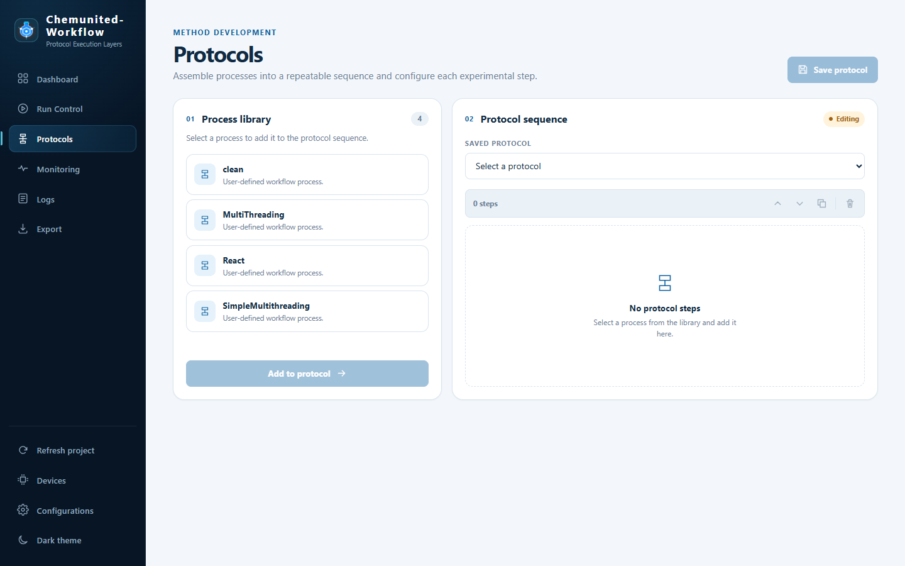

# Protocols

**Protocols** assembles the project's processes into a saved, repeatable sequence — the protocol files you select
in [Run Control](run_control.md).

## Process library

The left card lists every process registered in the project (built in
[Build Protocols](../protocols/build_protocols.md)), with a count badge showing how many are available. Select one
and click **Add to protocol** to append it to the sequence you're building.

## Protocol sequence

The right card is the sequence itself:

* **Saved Protocol** — a dropdown to load an existing saved protocol file for editing instead of starting from
  scratch.
* The step list shows each process you've added, in execution order, with controls to reorder (up/down), duplicate,
  or delete a step. An empty sequence shows **No protocol steps** until you add one from the library.
* **Duplicate** inserts a copy of the selected step directly below it, with the process parameters already set on it,
  under the next free index (for example `React_2`). Edit the copy freely — the original keeps its values.
* The status badge (e.g. `Editing`) reflects whether the currently loaded sequence has unsaved changes.

Click **Save protocol** to write the sequence out as a new, timestamped protocol file — saved protocols are
immutable, so saving again creates a new file rather than overwriting the one you loaded.

## Repeat groups

Select consecutive steps and choose **Repeat selected steps** to place them in a
collapsible group. A new group starts at 2 repeats; enter any whole number greater
than 1, without a fixed maximum. Each contained process stores its parameters
once, and every cycle uses those same values.

Move the group as a unit, reorder its children, or **Ungroup** to keep its body
once. **Show cycles** displays a paged execution preview; opening groups or
changing preview pages never duplicates the saved steps. Several sequential
groups are supported. Nested groups and per-cycle parameter overrides are not.

Save and run the grouped document normally. Saved files use schema version 2,
with counts stored as decimal strings to preserve large integers exactly.
Existing flat files remain readable and are not rewritten when opened or run;
saving creates a new v2 file. Malformed groups fail validation before a run is
accepted or any platform commands are issued.

In **Run Control**, each repeat group shows the current cycle and the number of
completed cycles. The active cycle contains the normal process/node cards;
completed cycles remain expandable, and large cycle lists are paged. Errors and
pending operator prompts remain visible in collapsed summaries. If a run stops,
future cycles are marked **Not executed**. Results and manifests identify each
execution separately, including its source step and cycle.

The accepted protocol and resolved defaults are frozen at Start. Editing or
deleting the saved file cannot change later cycles in that run. Repetition does
not add delays: add an ordinary delay process inside or after a group as needed.

The standalone chemistry simulator adapter currently rejects v2 documents with a
descriptive error. Use the workflow dashboard/API to run native repeat groups.

<strong>💡 Information</strong> 
To delete a saved protocol file, select it in <a href="run_control.md">Run Control</a> and click the trash icon
next to the Protocol dropdown, or use the API/MCP surface — see <a href="api_and_mcp.md">API & MCP Tools</a>.

