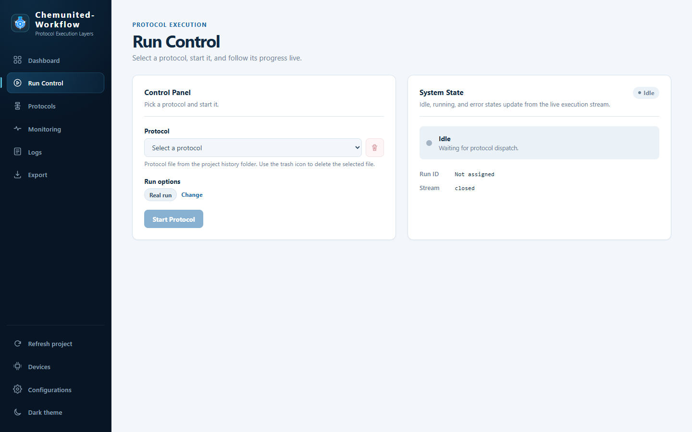

# Run Control

**Run Control** starts and cancels runs, and shows their progress live as they execute.

## Control Panel

| Field | Description |
|---|---|
| **Protocol** | Which saved [protocol](protocols.md) file to run — pulled from the project's protocol history folder. |
| **Run options** | The options the run starts with: **Real run** or **Dry run**, plus **Error-resilient**, **Recording** and **Timeout** when they're set. **Change** opens them under [Configurations](configurations.md#run-control). |

Click **Start Protocol** to dispatch the run. If a run is already active, starting another is rejected until the
current one finishes or is cancelled.

To remove a protocol file you no longer need, select it and click the **trash icon** next to the Protocol dropdown.
After you confirm, the `.json` file is permanently deleted from the project's protocol history folder. The button is
disabled while a run is active, and a protocol that the active run was started from can't be deleted.

## System State

The right-hand card reflects the run's state live, streamed over Server-Sent Events rather than requiring a manual
refresh:

* **Status badge** — `Idle`, `Running`, or an error state.
* **Run ID** — the identifier of the active run, once one is dispatched.
* **Stream** — whether the live event connection is `open` or `closed`.

When the protocol's processes declare an [estimated duration](../protocols/script_editor.md#estimated-duration),
three more rows appear. Projects that don't use estimates don't show them.

* **Estimate** — the protocol's estimated total, shown as soon as you select a protocol. Executions without an
  estimate are counted rather than guessed, for example `≈ 2 h 30 min · 2 executions not estimated`.
* **Remaining** — during a run, the estimated time left: every execution not started yet, plus what is left of
  the current one. It holds still while the run is paused.
* **Finish** — during a run, the clock time the run should end. It moves later while the run is paused. It reads
  `after 14:35` rather than `≈ 14:35` when some of the remaining executions have no estimate.

Estimates only inform: a step that takes longer than its estimate keeps running. Until it ends, **Remaining**
counts only the steps after it, and **Finish** keeps moving later.
