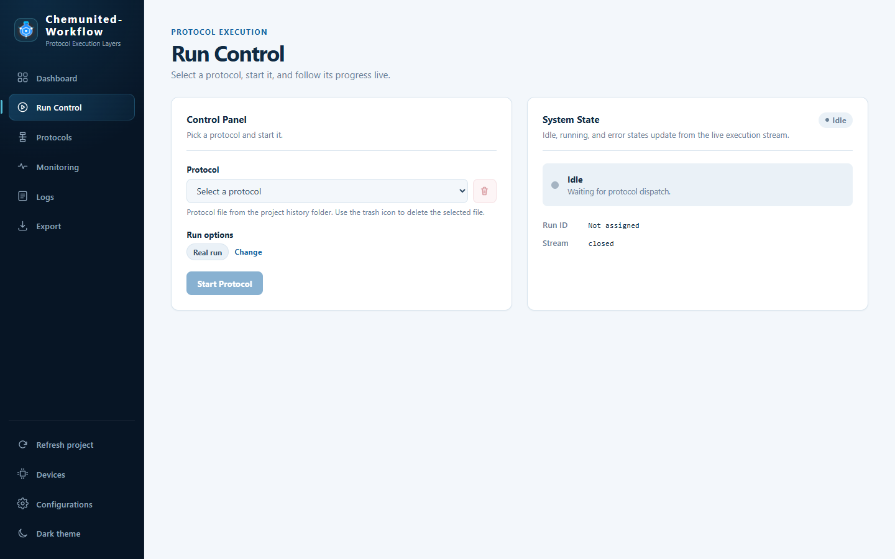

# Run Control

**Run Control** starts and cancels runs, and shows their progress live as they execute.

## Control Panel

| Field | Description |
|---|---|
| **Protocol** | Which saved [protocol](protocols.md) file to run — pulled from the project's protocol history folder. |
| **Run options** | The options the run starts with: **Real run** or **Dry run**, plus **Error-resilient**, **Recording** and **Timeout** when they're set. **Change** opens them under [Configurations](configurations.md#run-control). |

Click **Start Protocol** to dispatch the run. If a run is already active, starting another is rejected until the
current one finishes or is cancelled.

To remove a protocol file you no longer need, select it and click the **trash icon** next to the Protocol dropdown.
After you confirm, the `.json` file is permanently deleted from the project's protocol history folder. The button is
disabled while a run is active, and a protocol that the active run was started from can't be deleted.

## System State

The right-hand card reflects the run's state live, streamed over Server-Sent Events rather than requiring a manual
refresh:

* **Status badge** — `Idle`, `Running`, or an error state.
* **Run ID** — the identifier of the active run, once one is dispatched.
* **Stream** — whether the live event connection is `open` or `closed`.
