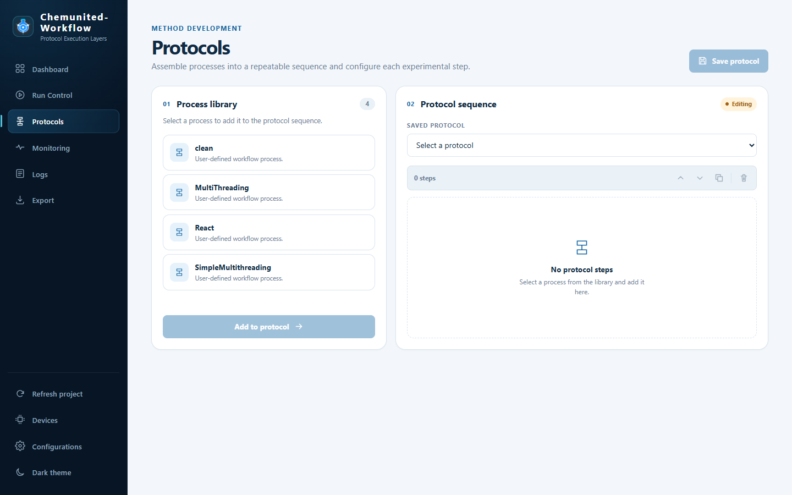
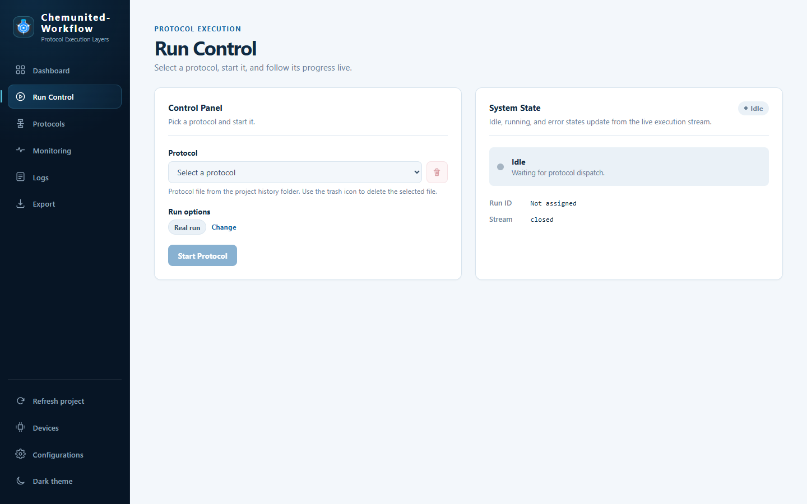

# Run a Protocol

This tutorial continues from [Build a Protocol](protocols_tutorial.md): with your processes built and the project
saved, you assemble them into a protocol and run it from the [Dashboard](../dashboard/overview.md).

***

## Step 1 — Launch the dashboard

Open the **Run** step of the desktop app and click **Launch Dashboard**. The badge shows **Starting…**, then the
dashboard opens in your browser with your project loaded. See [Dashboard Launcher](../dashboard/launcher.md).

***

## Step 2 — Assemble the protocol

On the dashboard's **Protocols** page, add the processes in the order they should run, set each step's parameters
and the experiment parameters, and click **Save protocol**. See [Protocols](../dashboard/protocols.md).

***

## Step 3 — Run it

On **Run Control**, select the protocol you saved and click **Start Protocol**. The process cards follow each step
and node as it executes. To check the protocol without calling the devices, first turn on **Dry run** under
[Configurations](../dashboard/configurations.md#run-control): Run Control then shows a **Dry run** chip. See
[Run Control](../dashboard/run_control.md).

***

## Next steps

To watch the platform while it runs, start monitoring on the [Monitoring](../dashboard/monitoring.md) page: the
Dashboard page's platform view then follows the devices live. Past runs can be downloaded from
[Export](../dashboard/export.md).
